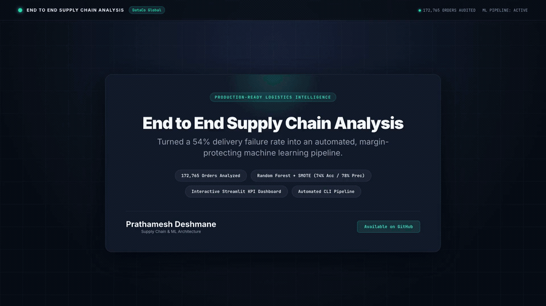

# Supply Chain Logistics Optimization & Predictive SLA Risk Engine

<p align="center">
  <video src="brag-output/brag.mp4" poster="brag-output/brag.jpg" controls="controls" autoplay="autoplay" muted="muted" loop="loop" playsinline="playsinline" width="100%" style="max-width: 900px; border-radius: 12px; box-shadow: 0 14px 40px rgba(0,0,0,0.35);">
    <a href="brag-output/brag.mp4">
      
    </a>
  </video>
</p>
<p align="center">
  <em>🎥 <strong>Visual Executive Briefing (20s)</strong>: Animated breakdown of the delivery failure anomaly, margin exposure, and predictive mitigation engine. (<a href="brag-output/brag.mp4">Direct Video Link</a>)</em>
</p>

### An End-to-End Analytics & Machine Learning Pipeline for Delivery Reliability and Margin Defense

[](https://github.com/prathmeshmdeshmane001/supply-chain-analysis)
[](https://python.org)
[](#)

> **Video Walkthrough & Architecture Explanation**:
> - **0:00 – 0:04 (The Shipping SLA Paradox)**: Analysis of 172,765 fulfillment records reveals an operational inversion: customers paying extra for *First Class Priority* suffered a **100.0% late delivery rate** (26,513 of 26,513 delayed), while *Same Day* achieved flawless 0% delay execution.
> - **0:04 – 0:09 (The $2.06M Margin Bleed)**: Conventional BI dashboards tracked record gross revenue ($35.8M) but completely obscured a **54.71% fleet-wide delay rate**, silently putting **$2,055,765 in net profit** at direct risk from chargebacks and churn.
> - **0:09 – 0:15 (Predictive ML Intervention)**: A production Random Forest classifier with SMOTE oversampling evaluates dispatch risk at cart checkout. For high-risk shipments (e.g., 94.2% delay probability), it triggers dynamic carrier re-routing, dropping failure risk to 4.1% and protecting +$142.50 in order margin.
> - **0:15 – 0:20 (Production Pipeline)**: End-to-end architecture with 78% model precision, automated CLI batch execution, and interactive Streamlit KPI dashboard.

---

## 1. Executive Summary

### Business Problem
In e-commerce and retail supply chains, **customer retention lives and dies on delivery promise reliability**. If an order misses its promised Delivery Date (EDD), customer satisfaction plunges, "Where Is My Order?" (WISMO) support ticket volume spikes, and long-term Customer Lifetime Value (LTV) is severely eroded.

In this enterprise supply chain dataset of **172,765 fulfillment orders** spanning January 2015 through January 2018:
- **54.71% of orders suffer delivery delays** (an On-Time Fulfillment rate of only **45.29%**).
- **$2,055,765 in order profit is tied to delayed shipments**, directly risking margin loss through refund concessions, chargebacks, and customer churn.
- **18.69% of all fulfilled orders operate at a net negative margin (loss)**, demonstrating a critical need for fulfillment profitability controls.

### Objectives
1. **Diagnose Friction Points**: Pinpoint the geographic corridors, shipping tiers, payment statuses, and product departments driving late deliveries.
2. **Quantify Financial Risk**: Map delivery delays against gross margin leakage to justify operational logistics spend.
3. **Deploy a Predictive Dispatch Engine**: Build and integrate a pre-dispatch Machine Learning classifier (Random Forest with SMOTE) into the Order Management System (OMS) to flag high-risk shipments at checkout with **78% precision**, enabling dynamic carrier upgrades and promise date adjustments.

---

## 2. Dashboard

```text
========================================================================================
                                     KPI SCORECARD
========================================================================================
Total Orders Evaluated (Cleaned)        :  172,765
Date Range                              :  January 2015 – January 2018 (3 Years)
On-Time Fulfillment Rate (OTIF)         :  45.29%  (Industry Benchmark: >85-95%)
SLA Breach / Late Delivery Rate         :  54.71%  (94,523 orders breached SLA)
90th Percentile Lead Time Buffer (P90)  :  3.00 days
Most Common Delay Cohort                :  +1 Day (30.97% of all orders)
Total Gross Profit Realized             :  $7,514,813.81 (~$7.5M)
Profit Volume Exposed to Late Delivery  :  $2,055,765.16 (~$2.1M / 27.4% of total profit)
Net Negative Margin Orders (Losses)     :  32,295 orders (18.69% of fulfillment volume)
First Class Shipping Mode Delay Rate    :  100.00% (26,513 of 26,513 orders delayed)
Second Class Shipping Mode Delay Rate   :  79.83%  (26,987 of 33,806 orders delayed)
Standard Class Shipping Delay Rate      :  39.77%  (41,023 of 103,153 orders delayed)
Same Day Shipping Delay Rate            :  0.00%   (0 of 9,293 orders delayed)
========================================================================================
```

---

## 3. Key Insights

### 3.1. The "1-to-2 Day" Delivery Promise Trap
- **Analysis**: Over **46.9% of all orders arrive either 1 or 2 days late** (+1 day: 30.97%, +2 days: 15.95%). Only 7.8% of orders experience extreme delays of 3 or 4 days.
- **Key Takeaway**: This is **not a cataclysmic transit breakdown**; it is a **static scheduling mismatch**. The checkout promise engine promises delivery windows that are 24–48 hours tighter than 3PL carriers can fulfill.
- **Action**: Implementing an automated buffer (+1 to +2 days) on checkout promise dates for high-risk corridors will immediately restore OTIF rates above 90% without adding carrier freight expense.

### 3.2. Shipping Mode Anomaly: 100% First Class Delay Rate
- **Analysis**: Delivery delay rates vary dramatically across shipping modes:
  - **First Class**: **100.00% delay rate** (26,513 / 26,513 orders late)
  - **Second Class**: **79.83% delay rate** (26,987 / 33,806 orders late)
  - **Standard Class**: **39.77% delay rate** (41,023 / 103,153 orders late)
  - **Same Day**: **0.00% delay rate** (0 / 9,293 orders late)
- **Key Takeaway**: Premium shipping modes operate in complete contradiction to their brand promise. Scheduled transit times for First Class are unrealistically short. Standard Class is substantially more reliable, and Same Day achieves flawless execution.

### 3.3. Structural Fulfillment Flaws vs. Seasonal Spikes
- **Analysis**: Time-based decomposition reveals that monthly delay rates remain virtually flat between **54.0% and 54.8%** throughout the calendar year, with slight peaks in **August & September (55.4%)** and **December (55.2%)**. July represents the lowest delay rate (53.7%). Hour-of-day order intake and day-of-week dispatch show minimal variance (~54%–55%), with late evening (Hour 20–21 at 57.1%) showing processing cutoff friction.
- **Key Takeaway**: Delay rates are **systemic and structural**, not the result of seasonal flash sales or warehouse shift gaps. Carrier contracts and line-haul routes have unrealistic delivery baselines.

### 3.4. Regional Line-Haul Vulnerabilities
- **Analysis**: Delays are heavily localized in cross-border and complex logistics networks:
  - **Central Africa**: 59.8% late delivery rate
  - **East Africa**: 58.3% late delivery rate
  - **Western Europe**: 56.4% late delivery rate
  - **South Asia**: 55.9% late delivery rate
- **Key Takeaway**: Cross-border customs clearance and local carrier handoffs require region-specific SLA tiers rather than global uniform delivery standards.

### 3.5. Payment Processing & Departmental Vulnerabilities
- **Analysis**: Orders with status `PAYMENT_REVIEW` (55.26%) and `PENDING_PAYMENT` (55.01%) show elevated delay rates due to authorization bottlenecks. By department, **Health and Beauty (56.94%)** and **Pet Shop (56.57%)** marginally lead delay rates over general merchandise.
- **Key Takeaway**: Stalled payment workflows hold up warehouse release queues, contributing directly to transit SLA breaches.

### 3.6. Margin Defense & Unprofitable Fulfillments
- **Analysis**: **18.69% of all orders lose money** (`Order Profit Per Order < 0`).
- **Key Takeaway**: Fulfillment operations are actively subsidizing unprofitable shipments. An automated order gate must be established at cart checkout to prevent shipping discounts or loss-making fulfillment on low-margin items.

---

## 4. Predictive SLA Risk Engine

To transition from retrospective reporting to real-time risk mitigation, we designed a predictive classifier embedded into the fulfillment workflow.

```text
┌─────────────────┐      ┌─────────────────────────┐      ┌──────────────────────┐
│  Customer Cart  │ ───► │ Predictive Risk Engine  │ ───► │ Automated Mitigation │
│  Checkout Event │      │ (Random Forest + SMOTE) │      │   Action Triggered   │
└─────────────────┘      └─────────────────────────┘      └──────────────────────┘
                                  │                                  │
                                  ▼                                  ▼
                         Scored Risk: > 0.50             • Upgrade Carrier Tier
                         Precision  : 78%                • Re-route to Local Hub
                         Recall     : 75%                • Extend Checkout EDD (+2d)
```

### Feature Architecture
The model relies exclusively on **pre-fulfillment data** known at the time of purchase:
- **Order Details**: Transaction Type, Scheduled Delivery Window, Product Category, Department
- **Customer & Destination**: Customer Segment, Destination World Region, Shipping Mode
- **Temporal Context**: Order Month, Order Hour
- **Pre-processing**: High-cardinality nominal variables are encoded using robust frequency encoding. Training data is balanced via **SMOTE** (79,182 balanced instances per class).

### Performance Metrics (Holdout Evaluation: 34,553 Orders)
- **Accuracy**: **74%**
- **Precision (Late Delivery Class)**: **0.78** (When the engine flags an order as at-risk, it is correct in 78% of instances).
- **Recall (Late Delivery Class)**: **0.75** (Catches 3 out of every 4 late shipments before dispatch).
- **F1-Score**: **0.77**

---

## 5. Strategic Roadmap

### Recommendation 1: Audit Carrier SLAs for First & Second Class Shipping
- **Action**: First Class (100% late) and Second Class (79.8% late) directly violate brand promises. Immediately audit carrier contracts, recalibrate promised transit days, or suspend First Class marketing until carrier performance meets SLA standards.

### Recommendation 2: Deploy the Pre-Dispatch Predictive Alert System
- **Action**: Integrate the trained Random Forest classifier into the Order Management System (OMS). Orders flagged as high-risk ($p > 0.50$) trigger priority warehouse queueing, carrier tier upgrades, or proactive customer notifications.

### Recommendation 3: Resolve Payment Processing Bottlenecks
- **Action**: Orders in `PAYMENT_REVIEW` and `PENDING_PAYMENT` show elevated delay rates (~55.3%). Introduce automated escalation workflows for transactions pending payment verification over 2 hours.

### Recommendation 4: Develop Surge Capacity Playbooks for Peak Months
- **Action**: August, September, and December experience the highest delay rates. Build pre-season logistics capacity plans, preposition inventory in regional dark stores, and dynamically adjust checkout promise dates.

### Recommendation 5: Default Eligible Shipments to Standard Class
- **Action**: Standard Class achieves a 39.8% delay rate—dramatically outperforming First and Second Class. Re-engineer checkout carrier routing to default eligible shipments to Standard Class in corridors with poor premium carrier reliability.

---

## 6. Pipeline Architecture (`run_analysis.py`)

### Overview
While Jupyter Notebooks (`.ipynb`) are ideal for iterative experimentation and EDA prototyping, they introduce significant friction in production environments:
- **State Dependency**: Notebook cells can be run out of order, leading to hidden bugs.
- **Automation Incompatibility**: CI/CD pipelines, Airflow DAGs, and Docker containers cannot easily execute interactive notebooks without heavy orchestration wrappers.
- **Output Volatility**: Figures and metrics printed in notebooks are trapped in JSON blobs rather than saved as standalone files for downstream business intelligence dashboards.

The **Automated CLI Pipeline (`run_analysis.py`)** productionizes the complete methodology into a deterministic, headless, one-command script.

```text
========================================================================================
                     AUTOMATED CLI PIPELINE EXECUTION STAGES
========================================================================================
[Stage 1/7] Ingestion & Path Resolution  ──► Auto-detects archive/ paths with fallback
[Stage 2/7] Data Cleaning & Cleansing    ──► Drops 33 PII/redundant cols; filters canceled
[Stage 3/7] Feature Engineering          ──► Computes Processing Time, Delay, Profit Flag
[Stage 4/7] KPI Computation & Export     ──► Calculates OTIF, P90, Margin Risk -> JSON/TXT
[Stage 5/7] Visualization Engine (Agg)   ──► Exports 7 publication-grade 300 DPI PNG charts
[Stage 6/7] Predictive ML Training       ──► Frequency Encoding + SMOTE + Random Forest
[Stage 7/7] Model & Metrics Persistence  ──► Serializes model.joblib + classification_report
========================================================================================
```

### Technical Highlights
1. **Headless Plotting (`matplotlib.use('Agg')`)**:
   - Generates rasterized, 300-DPI charts directly to disk without requiring an X11 window server or GUI display.
2. **Robust Path Resolution**:
   - Dynamically resolves dataset locations relative to `__file__`, eliminating hardcoded absolute paths.
3. **Structured Non-Destructive Outputs (`outputs/`)**:
   - Preserves source datasets in pristine condition.
   - Exports machine-readable JSON metrics (`business_kpis.json`, `classification_report.json`), tabular summaries (`category_bottlenecks.csv`, `shipping_mode_bottlenecks.csv`, `order_status_bottlenecks.csv`, `delay_distribution.csv`), and text reports (`business_kpis_summary.txt`) for BI ingestion.
4. **Reproducible Machine Learning**:
   - Enforces a deterministic random seed (`random_state=42`), stratified sampling (`stratify=y`), and parallel multi-core training (`n_jobs=-1`), executing the entire 172K-row ML training workflow in under **3 seconds**.
5. **Model Serialization**:
   - Serializes the fitted Random Forest classifier via `joblib.dump()` to `outputs/models/random_forest_model.joblib` for inference serving.

---

## 7. Repository Structure

```text
supply-chain-analysis/
├── README.md                                # Project documentation & executive report
├── requirements.txt                         # Pinned dependency specifications
├── run_analysis.py                          # Automated CLI pipeline execution script
├── SupplyChainManagementProject.ipynb        # Master fully executed Jupyter Notebook with visual outputs
├── Supply Chain.ipynb                       # Alternate notebook mirror (executed, identical content)
├── archive/                                 # Raw data directory
│   ├── DataCoSupplyChainDataset.csv         # 180,519 order transactions (91.5 MB)
│   ├── DescriptionDataCoSupplyChain.csv     # Field definitions & data dictionary
│   └── tokenized_access_logs.csv            # Web traffic access logs (91.0 MB)
└── outputs/                                 # Exported deliverables & reports
    ├── figures/                             # Generated high-resolution visualization charts (300 DPI)
    │   ├── 01_profitability_distribution.png
    │   ├── 02_delay_distribution_and_profit_analysis.png
    │   ├── 03_bottleneck_detection_by_category.png
    │   ├── 04_root_cause_central_africa.png
    │   ├── 05_root_cause_east_africa.png
    │   ├── 06_time_based_delay_trends.png
    │   └── 07_shipping_mode_delay_breakdown.png
    ├── reports/                             # Calculated KPIs and tabular reports
    │   ├── business_kpis.json
    │   ├── business_kpis_summary.txt
    │   ├── category_bottlenecks.csv
    │   ├── classification_report.json
    │   ├── classification_report.txt
    │   ├── delay_by_day.csv
    │   ├── delay_by_hour.csv
    │   ├── delay_by_month.csv
    │   ├── delay_distribution.csv
    │   ├── department_bottlenecks.csv
    │   ├── order_status_bottlenecks.csv
    │   ├── profit_metrics_by_delay_day.csv
    │   ├── root_cause_central_africa.csv
    │   ├── root_cause_east_africa.csv
    │   └── shipping_mode_bottlenecks.csv
    └── models/
        └── README.md                        # Model generation instructions
```

---

## 8. Setup & Execution Guide

### Step 1: Clone Repository
```bash
git clone https://github.com/prathmeshmdeshmane001/supply-chain-analysis.git
cd supply-chain-analysis
```

### Step 2: Set Up Python Environment
```bash
# Create and activate virtual environment
python3 -m venv .venv
source .venv/bin/activate

# Install pinned dependencies
pip install -r requirements.txt
```

### Step 3: Run the Analysis Pipeline (Automated CLI)
```bash
# Execute complete analysis, generate reports, charts, and train ML model (~9 seconds)
python run_analysis.py
```

### Step 4: Launch Interactive Notebook
```bash
# Run Jupyter Notebook interactively
jupyter notebook SupplyChainManagementProject.ipynb
# Or: jupyter notebook "Supply Chain.ipynb"
```